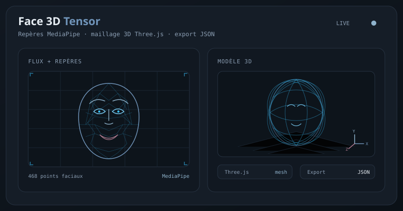
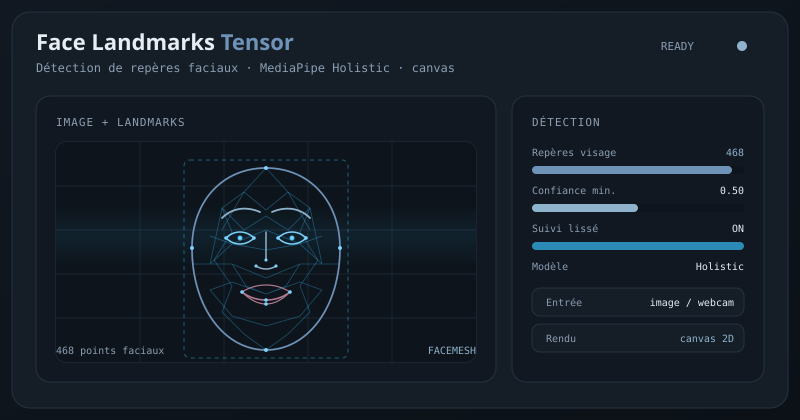

# Tensor Lab

Portail des applications de machine learning interactives (TensorFlow.js), avec le thème **Graphite** (sombre, accent bleu vif).

## Ouvrir Tensor Lab

[Ouvrir Tensor Lab](https://kewinmarchand.github.io/tensor-lab/)

## Les applications

### Fear & Greed Tensor

[Ouvrir l’app](https://kewinmarchand.github.io/tensor-lab/apps/fear-greed/) · [Code source](https://github.com/kewinMarchand/tensor-lab/tree/main/apps/fear-greed) — Indice Fear & Greed BTC/USD, graphiques horaires/journaliers/hebdomadaires, entraînement et prévisions avec TensorFlow.js. *(Démo GitHub Pages : frontend statique + backend Node.js hébergé sur Render ; cold start possible sur l’offre gratuite.)*

### Baseball Tensor

[Ouvrir l’app](https://kewinmarchand.github.io/tensor-lab/apps/baseball/) · [Code source](https://github.com/kewinMarchand/tensor-lab/tree/main/apps/baseball) — Classification des lancers MLB (Statcast) par réseau de neurones : entraînement, visualisation et inférence interactive. *(Démo GitHub Pages : frontend statique + backend Node.js hébergé sur Render ; cold start possible sur l’offre gratuite.)*

### Face 3D Tensor

[Ouvrir l’app](https://kewinmarchand.github.io/tensor-lab/apps/face-3d-tensor/) · [Code source](https://github.com/kewinMarchand/tensor-lab/tree/main/apps/face-3d-tensor) — Modélisation faciale 3D en temps réel : détection de repères avec MediaPipe Holistic, visualisation et export 3D avec Three.js.

### Face Landmarks Tensor

[Ouvrir l’app](https://kewinmarchand.github.io/tensor-lab/apps/face-landmarks-tensor/) · [Code source](https://github.com/kewinMarchand/tensor-lab/tree/main/apps/face-landmarks-tensor) — Détection de repères faciaux sur image ou webcam avec MediaPipe Holistic et rendu sur canvas.

## Lancement local (expérience complète)

Les applications utilisent un backend Node.js (Socket.IO) pour les données/entraînement en temps réel. Depuis la racine du monorepo :

- **Fear & Greed Tensor** : `cd apps/fear-greed && npm install && npm run dev` → http://localhost:8082 (backend :8002)
- **Baseball Tensor** : `cd apps/baseball && npm install && npm run dev` → http://localhost:8080 (backend :8001)

## Thème

Le portail et les applications utilisent le thème **Graphite** (sombre, sobre, accent bleu vif) via les fichiers de thème partagés (`packages/theme-graphite`, thèmes d’app) et les styles propres à chaque app.

Ce dépôt (monorepo `tensor-lab`) regroupe le portail et les applications de la collection.
